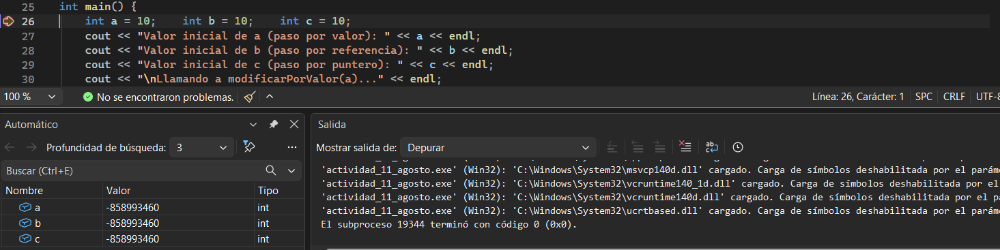

# BreakPoints
Los breakpoints son una herramienta dentro del software de visual studio en el cual se colocan en una en específico para ver los valores que tengan las variables internas.
También siendo posible identificar su posición en la RAM

    Como se puede ver en la parte inferior  de la imagen, nos está mostrando los valores a los que están igualados en esa línea de código
# Referencias a través de punteros
En C++, a diferencia de C#, se utiliza la herramienta del puntero manualmente dentro del código.
El puntero se encarga de acceder al valor de una variable y modificarlo de tal manera que no salga error en la compilación (por eso es muy usado para modificar valores localmente dentro de funciones)

