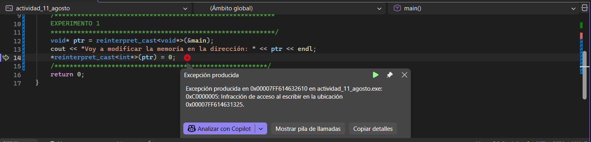
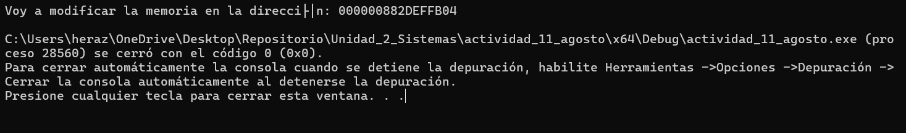
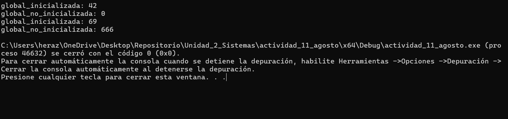

# Modificando secciones de código
# modificando el stacj

Cómo se observa acá, al tratar de modificar las variables están apareciendo problemas por la línea de código llamada
    ```
    void* ptr = reinterpret_cast<void*>(&main);
    ```
ya que esta cómo se observa al final, está tratando de referenciar el main y tratando de cambiar sus valores desde el main, en vez de la sección de código stack
Por eso, si queremos cambiar un valor arbitrariamente, referenciamos la variable a modificar

    Ahora sí, está compilando de manera natural (ya que se cambió la referencia de &main a &a)
# modificando variables globales


# Variables constantes en C++
Cuando a una variable se le asigna este valor
    const char* const mensaje_ro = "Hola, memoria de solo lectura";
    ese const va a representar que la variable no puede ser modificada bajo ninguna circunstancia
# Modificar el heap

# Diferencias del comportamiento del Heap y del Stack