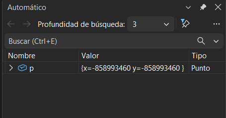

# Tengamos en cuenta esta siguiente sección de código
    int main() {
	// Coloca un breakpoint en la siguiente línea
	Punto p(10, 20);
	// Muestra el contenido del objeto
	p.imprimir();
	// Utiliza el depurador para inspeccionar 'p', observa la dirección de memoria y el valor de x e y.
	return 0;
}

